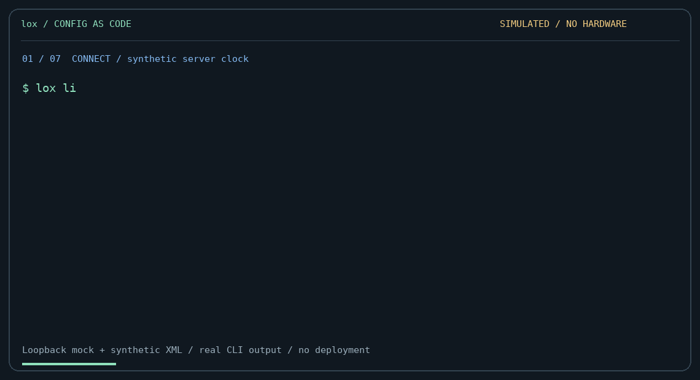

# lox — AI Agent Tooling for Loxone Miniserver

[](https://github.com/eisber/lox-cli/actions/workflows/ci.yml)
[](https://crates.io/crates/lox-cli)
[](https://www.gnu.org/licenses/agpl-3.0)
[](#eval-results)

**Tell an AI agent what you want. It configures your Loxone Miniserver.**

*"Set up the kitchen so the light comes on when dark, blinds go up in strong wind, and they close after five minutes of sunshine if there's no wind."* → Agent searches block types, adds 5 logic blocks, wires 3 circuits, fixes a pulse duration error after sim feedback, and verifies all 7 test scenarios — in under 5 minutes.

<p align="center">
  
  <br><sub>Simulated sandbox · actual CLI output · no hardware or deployment · <a href="docs/demo.md">Reproduce this 30-second demo</a></sub>
</p>

## Why

[Loxone Config](https://www.loxone.com/enen/products/software/loxone-config/) is a 400MB Windows-only desktop app. You drag blocks onto a canvas, wire them by hand, and hope you didn't miss a connection. For a single room with lighting, blinds, and climate you're easily placing 15+ blocks and 30+ wires.

This CLI replaces that with shell commands an AI agent can call. The agent reads a [skill reference](.github/skills/loxone-config/SKILL.md) (block types, connectors, common mistakes), builds the circuit, then self-tests with an offline SPS simulator — catching wiring errors before anything touches your live system.

Works with [GitHub Copilot CLI](https://docs.github.com/en/copilot/github-copilot-in-the-cli), [Claude Code](https://docs.anthropic.com/en/docs/agents-and-tools/claude-code/overview), [OpenCode](https://opencode.ai), or any agent that can run shell commands.

## Install

**Homebrew** (macOS/Linux):
```bash
brew install eisber/tap/lox-cli
```

**Prebuilt binaries** (Linux, macOS, Windows) — see [Releases](https://github.com/eisber/lox-cli/releases):
```bash
curl -LO https://github.com/eisber/lox-cli/releases/latest/download/lox-cli-linux-x86_64
chmod +x lox-cli-linux-x86_64 && sudo mv lox-cli-linux-x86_64 /usr/local/bin/lox
```

**From crates.io:**
```bash
cargo install lox-cli
```

**From source:**
```bash
git clone https://github.com/eisber/lox-cli && cd lox-cli
cargo build --release    # Binary at target/release/lox (~14MB)
```

**Requirements:** Offline file editing and simulation need no Miniserver.
Network operations need access to a Loxone Miniserver Gen 1 or 2 (firmware 12.0+).

## Quick Start

Start with an exported `.Loxone` XML file. This example moves matching existing
controls to an existing room, previews the change, then saves a separate file.
Replace `Desk light` and `Office` with names from your project; `--title` matches
by substring and may select more than one control.

```powershell
# Inspect the project without connecting to a Miniserver
lox config rooms project.Loxone -o json
lox config controls project.Loxone -o json

# Preview room assignments without writing
lox config control move project.Loxone --title "Desk light" --to-room Office --dry-run -o json

# Apply the same selection to a new file, leaving the original untouched
lox config control move project.Loxone --title "Desk light" --to-room Office --save-as edited.Loxone

# Review structural changes and run static checks
lox config diff project.Loxone edited.Loxone -o json
lox config check edited.Loxone -o json
```

`diff` compares structural summaries, not every nested XML value. `check` is
static validation, not a simulator or hardware test. Neither command deploys
the file. Use `lox sim run` for supported behavioral tests before an explicit
deployment.

To download a project first, configure a connection and use the filename printed
by `download` in the workflow above:

```bash
lox setup set --host https://192.168.1.100 --user admin --pass secret
lox config download --extract
```

## Command Surface

These are command families, not a promise that every flag or storage shape is
supported. [COMMANDS.md](COMMANDS.md) documents exact syntax and restrictions.
Use `lox <command> --help` for individual flags or `lox schema` for the
machine-readable command tree.

| Area | Command prefix | Subcommands | Purpose |
|---|---|---|---|
| Project inspection | `lox config` | `describe`, `rooms`, `controls`, `devices`, `users`, `diff`, `connectors`, `get-params`, `wires` | Inspect exported XML, hardware, settings, connections and structural differences. |
| Blocks, rooms and wiring | `lox config` | `add`, `room`, `control`, `set-param`, `wire-connector`, `device-bind`, `template`, `layout`, `splice-actor` | Create/configure blocks, move or rename controls, and edit connections in local files. |
| Lighting | `lox config` | `lighting`, `moods`, `add-mood`, `set-mood-color`, `central-light` | Inspect/edit stored moods, levels, supported RGB, identities and central navigation links. Raw packed-color editing is separate. |
| Energy and load management | `lox config` | `energy`, `load-manager`, `status-monitor`, `irrigation-zone-set-name` | Inspect/edit supported load records, state priorities and irrigation names. |
| Schedules and alarms | `lox config` | `timer-schedule`, `timer-entry-*`, `alarm-entry-*`, `calendar-add`, `mode-list` | Edit supported intervals and alarm entries; inspect global operating modes. |
| Virtual inputs and programs | `lox config` | `add-virtual-in`, `set-virtual-input-format`, `set-input-inversion`, `get-program`, `set-program` | Configure supported inputs and SequenceController program text. |
| Users, MQTT and rules | `lox config` | `user-add`, `user-remove`, `user-grant`, `user-revoke`, `user-perms`, `mqtt`, `autopilot-*` | Manage local configuration permissions, brokers/topics and supported rule actions. |
| Low-level XML | `lox config xml` | `set-property`, `set-attr`, `move`, `add`, `remove` | Explicit XML edits, not automatic reference repair. |
| Validation | `lox config` | `check`, `validate`, `scan` | Static configuration checks and diagnostics. |
| Archives and deployment | `lox config` | `ls`, `download`, `extract`, `compress`, `upload`, `push`, `push-http`, `patch`, `snapshot` | Convert backups, acquire projects and explicitly deploy changes; network/write effects vary. |
| Version history | `lox config` | `init`, `pull`, `log`, `restore` | Git-backed configuration history and restoration. |
| Live state | `lox live` | `get`, `set`, `time` | Read state; write only with `set --write`. `time` is an auxiliary Miniserver date/time read, not clock synchronization. |
| Logged statistics | `lox stats` | `ls`, `get`, `download` | Read the Miniserver's statistics index/values and download monthly XML files. |
| Offline simulation | `lox sim` | `check`, `run`, `step`, `dump` | Inspect the simulation graph and exercise supported behavior without hardware. |
| Block reference | `lox blocks` | `search`, `info`, `list` | Find automation block definitions and connectors. |
| Documentation | `lox docs` | Search argument; `--list`, `--schema`, `--datasheet` | Browse bundled articles, schemas and datasheets. |
| Color codecs | `lox color` | `encode`, `decode` | Convert composite color values offline. |
| Connection settings | `lox setup` | `set`, `show` | Configure Miniserver connection settings. |
| Contexts | `lox ctx` | `add`, `use`, `list`, `current`, `remove`, `rename`, `init`, `migrate` | Select isolated connection/project contexts; `lox ctx NAME` also switches context. |
| Structure cache | `lox cache` | `info`, `clear`, `refresh`, `check` | Manage the cached Miniserver structure. |
| Authentication tokens | `lox token` | `fetch`, `info`, `clear`, `check`, `refresh`, `revoke` | Manage token acquisition, validation and lifecycle. |
| Agent/developer tooling | `lox` | `schema`, `completions`, `telemetry`, `report` | Discover commands, generate completions, control analytics and report issues. |

`timer-entry-*`, `alarm-entry-*` and `autopilot-*` are shorthand for families in
this table, not literal shell commands. Global `--dry-run` is fail-closed:
unsupported commands refuse rather than performing a write. JSON is available
with `-o json` / `--json`; CSV support varies by command.

## Rust, Python and Java/Kotlin

[`lox-core`](crates/lox-core/README.md) provides typed, headless archive codecs,
configuration inspection and selected byte-input edit transactions, control selection,
statistics, color and state-payload decoding, plus optional HTTP runtime
operations. The CLI owns filesystem/context selection, presentation and deployment
policy; not all of its behavior has migrated to Core.

The [native bindings](docs/toolkit-archive-bindings.md) call that Rust code
directly: Python does not shell out to `lox`, and Kotlin uses the same Java 22+
FFM API as Java. The heads are intentionally not feature-identical:

| Capability | CLI | Rust Core | Python | Java / Kotlin |
|---|---|---|---|---|
| LoxCC / backup ZIP codecs | Extract/compress files | Byte codecs | Native byte APIs | Same native byte APIs |
| Configuration inventory | Rooms, controls, devices, users, moods and more | Typed parsers and selected inspections | Selected native inventories | Same selected inventories |
| Structural diff and offline overlays | File diff and overlay workflows | Typed diff, three-way merge and supplied fragments | Native diff/merge APIs | Same native diff/merge APIs |
| Statistics | Acquire/list/read/download | Parse index/series, resolve identity, merge months | Offline parsing/selection/merge | Same offline APIs |
| Catalogs and color | CLI selection and color commands | Typed catalogs, selectors and codecs | Native catalogs/selectors/codecs | Same native APIs |
| State-event payloads | Not a general event subscription CLI | Numeric, text, Daytimer and Weather decoders | Complete-payload decoders | Same complete-payload decoders |
| Selected configuration writes | Broadest editing surface | Selected typed transactions | Offline Unwire and control-to-room move | Same selected transactions |
| SequenceController programs | Read and write | Supported text read | Native text read | Same native text read |
| Miniserver HTTP state | Live read/write | Shared read runtime; writes/session policy still CLI-owned | No control transport | No control transport |
| Miniserver date/time | Auxiliary `live time` | Clock client, cancellation and shutdown | Native sync/async clock handles | Same runtime via Java/Kotlin futures |
| Deployment, contexts and full authentication | CLI-owned workflows | Reusable primitives, not complete workflows | Not exposed | Not exposed |

For example, after building/installing the matching native Python package, inspect
the same offline files without invoking the CLI:

```python
from pathlib import Path
import lox_archive

before = lox_archive.parse_config_summary(Path("project.Loxone").read_bytes())
after = lox_archive.parse_config_summary(Path("edited.Loxone").read_bytes())
changes = lox_archive.diff_configs(before, after)
print(changes.has_changes)
```

The bindings are experimental, source-built packages with verified Windows AMD64
Python / Java 22 / Kotlin artifacts, not a general PyPI/Maven release or stable
ABI. Other platforms, full CLI parity, WebSocket subscriptions and native Config
or hardware equivalence are not claimed. See the binding guide's
[capability matrix](docs/toolkit-archive-bindings.md#actually-exposed-capabilities)
for exact APIs, supported subsets and build instructions.

## How It Works

```
User: "Close the living room blinds when it's sunny and above 25°C"
  ↓
Agent reads skill reference (.github/skills/loxone-config/)
  ↓
Agent runs CLI commands:
  lox blocks search "threshold"           → GreaterEqual
  lox config add --type GreaterEqual ...  → adds block, returns connector UUIDs
  lox config wire-connector ...           → wires sensor → logic → actuator
  lox sim run config.Loxone --sim '...'   → ✅ signal propagates correctly
  ↓
Config ready to deploy: lox config push config.Loxone --reboot
```

The CLI handles LoxCC compression, CRC32 checksums, UUID generation, connector maps for 221 block types, and wiring validation. All commands support `--json` (or `-o json`) for agent consumption.

`lox config energy` provides a validated **EnergyManager2 storage pilot**: inspect
stored/effective values, set three scalar parameters, and configure/reorder its
twelve existing load slots, including explicit customized-name clearing with
`--no-name`. It preserves full records and wiring, supports
`--dry-run`/`--save-as`, and does **not** claim complete GUI or runtime parity.
See [EnergyManager2 commands](COMMANDS.md#energymanager2-verified-storage-pilot).

`lox config status-monitor` inspects existing **Status Monitor** state priorities
and moves one configured row up/down by persistent State `Id`, retaining its
output association and wiring. Rest stays last; inherited/grouped configurations
and ambiguous storage are refused. This is source-backed local-file editing,
not a native GUI/runtime qualification. See
[Status Monitor priorities](COMMANDS.md#status-monitor-existing-state-priority).

`lox config lighting` inspects stored **LightController2** moods, per-output
numeric/color editor kinds and output references. Opaque values and unsupported
storage shapes remain unresolved; `set-mood-color` is still raw packed storage, not a
mode-aware equivalent. Its source-backed `recount-moods` repairs only the stored scene count,
preserving output widths, sparse values and unknown data; existing `add-mood`
also recounts and uses the recovered 18-output/type-preserving initialization
and native-style automatic SID/CID selection, with atomic exhaustion errors.
Explicit ID options retain their legacy behavior. These storage guarantees
are not native GUI/runtime parity. `lighting set-mood-level` validates the stored
numeric editor kind and writes a type-preserving level in 0..100, rejecting
color/unsupported modes and out-of-range values instead of clamping or RGB-packing.
One accepted native numeric edit/save/reopen confirms its selected encoding,
not the native dialog's unrelated output/HCL normalization. See
[Lighting commands](COMMANDS.md#lighting-stored-inspection-and-mood-count-repair).
`lighting set-mood-cid` separately supports existing-record CID swaps and
source-backed ordered SID/selection-reference updates, with atomic ambiguity
and exhaustion errors; it does not change `add-mood` override behavior.
Bounded `rename-mood` and `set-mood-mix` operations edit one existing Name or
eligible role-independent MixMod flag. Unsupported name normalization and
role-forced checkbox states are rejected, not silently approximated.
Omitted MixMod has the recovered default false and stays omitted on no-op;
unsupported explicit flag values are never silently defaulted.
Native ASCII boolean case variants are accepted without rewriting no-op spelling.
Omitted CID likewise uses recovered0 for mix eligibility without inserting an ID.
`lighting inspect-mood-options` reads raw/effective/default flags and display
text, with bounded cycling/mix projections rather than GUI-permission guesses.
IID is exposed as a numeric icon reference with unresolved catalog mapping,
not an input binding or a raw icon-assignment surface.
`lighting inspect-mood-references FILE BLOCK --mood SID_OR_NAME` reads the
selected stored SID's numeric matches in the available ScMv prefix bounded by
OpM count. It retains raw spellings and opaque unvisited tails, distinguishes
missing vectors from unsupported needed values, and rejects ambiguous identity.
This never saves or predicts Num-limited import, edit admission, GUI or runtime state.
`lighting set-mood-skip` changes only the cycling exclusion flag and reports
the native checkbox's inverse state. Omitted `SkipNext` means false; no-op
requests preserve omission, and unsupported explicit values fail atomically.
`lighting set-mood-display-name` edits only SName (uppercase ASCII or explicit
clear), separately from Name. `--normalize-ascii` explicitly enables recovered
lowercase ASCII conversion; default validation stays strict, without silent
transliteration. Inspection warns about numerically duplicated positive SIDs
and nonzero CIDs without rewriting stored identities.
`lighting set-mood-sid` supports ordinary SID1..90 reassignment and explicit
occupied-ID exchange (`--swap`), including ordered selection-reference remaps.
Free SID32..90 with positive CID requires `--allow-cid-clear`; occupied/no-op
branches retain CIDs. Ambiguous identities and temporary SID99 collisions fail.

---

## Config-as-Code

```bash
# Add logic blocks & wire them
lox config add --type GreaterEqual --title "Temp über 25" config.Loxone -o json
# {"ok":true,"uuid":"...","type":"GreaterEqual","connectors":[{"key":"Input1","uuid":"...","direction":"I"},...]

lox config set-param config.Loxone "Temp über 25" Input2 25
lox config wire-connector config.Loxone "Temp über 25.Input1" "Außentemperatur.AQ"
lox config wire-connector config.Loxone "Jalousie 1 [Wohnzimmer].InputTriggerDown" "Temp über 25.Q"

# Validate & test
lox config check config.Loxone -o json     # Structured warnings/errors
lox sim run config.Loxone --sim '{"inputs":{"Außentemperatur":30},...}'

# Deploy
lox config push config.Loxone --reboot --force  # Upload + SPS reload (~4s)
```

Room templates for common setups:
```bash
lox config template config.Loxone bedroom --room "DG Schlafzimmer"
# Creates LightController2, JalousieUpDown2, Thermostat with sensible defaults
```

User permissions (fixes HTTP 403 when an API user calls a new virtual input):
```bash
lox config user-grant config.Loxone webhook_api "UniFi Doorbell"   # idempotent; user-revoke undoes it
lox config user-perms config.Loxone webhook_api                    # list permitted objects
```

GitOps versioning:
```bash
lox config pull    # Download → diff → semantic commit message
lox config log     # Change history
```

## SPS Simulator

Offline Miniserver SPS simulator — test config changes without hardware:

- **215 block types** — logic, math, lighting, HVAC, timers, I/O
- **Topological engine** — automatic evaluation order, cycle detection
- **Temporal testing** — multi-step specs for heating cycles, timer delays, schedules
- **6k lines of Rust** in `lox-sim/` with 367 unit tests

```bash
lox sim run config.Loxone --sim '{
  "inputs": {"Außentemperatur": 30, "Sonnenschein": 1},
  "ticks": 10, "dt": 0.1,
  "expected_outputs": {"Jalousie 1 [Wohnzimmer].InputTriggerDown": {">": 0.5}}
}'
# {"pass":true,"passed":1,"scenarios":[{"pass":true,...}]}
```

---

## Eval Results

The eval harness tests whether an AI agent can correctly configure a Loxone Miniserver from natural language instructions. Each case: utterance → agent builds circuit via CLI → Rust simulator verifies signals propagate correctly.

**322 test cases across 13 categories.**

Raw LLM pass rate (agent builds circuit from scratch each run):

| Section | Score | Examples |
|---------|-------|---------|
| Synthetic | 20/20 (100%) | "Close blinds when sunny and above 25°C" |
| Patterns | 25/25 (100%) | Memory blocks, delayed triggers, schedules |
| Reference | 24/24 (100%) | Threshold, negation, fan-out, stairway light |
| Generated | 50/50 (100%) | Natural language variants, German/English |
| Rooms | 15/15 (100%) | Full room configurations (bedroom, bathroom, garden) |
| Extended | 14/15 (93%) | Pushbutton, AutoJalousie, sunrise triggers |
| Advanced | 28/29 (97%) | Multi-room goodnight, frost protection, solar pool |
| Use-Cases | 35/40 (88%) | Wallbox charging, NFC lockers, alarm systems |
| HVAC | 15/18 (83%) | Weather-compensated heating, dewpoint cooling |
| HVAC-Extracted | 26/32 (81%) | IRC zones, fancoil, HRV ventilation, heat pump |
| **Total** | **252/268 (94%)** | Core automation: 5 sections at 100% |

Non-deterministic: scores vary ±5% across runs. The remaining failures are complex HVAC chains and specialized hardware (wallbox billing, NFC lockers) where the agent times out or misses wiring.

### How Evals Work

Each eval case is a JSON spec with an utterance and simulation tests. The fixture config (`fixture.Loxone`) provides pre-configured rooms with sensors (temperature, motion, brightness) and actuators (blinds, lights, fans) — the agent adds logic blocks and wires them:

```json
{
  "id": "s01-piano-protection",
  "utterance": "Lower blinds in the living room when it's sunny and the temperature is over 25 degrees",
  "expected": {
    "simulation": [
      {
        "name": "blinds close when hot+sunny",
        "inputs": {"Außentemperatur": 30, "Sonnenschein": 1},
        "ticks": 10, "dt": 0.1,
        "expected_outputs": {"Jalousie 1 [Wohnzimmer].InputTriggerDown": {">": 0.5}}
      },
      {
        "name": "blinds stay when cold",
        "inputs": {"Außentemperatur": 15, "Sonnenschein": 0},
        "ticks": 10, "dt": 0.1,
        "expected_outputs": {"Jalousie 1 [Wohnzimmer].InputTriggerDown": {"<": 0.5}}
      }
    ]
  }
}
```

The pipeline:
1. **Agent** receives the utterance + fixture config (with sensors & actuators) + skill reference
2. **Agent** uses `lox config add`, `wire-connector`, `set-param` to add logic blocks and wire them
3. **Simulator** injects test values into sensors, ticks the engine, checks actuator outputs
4. **Pass/fail** based on whether the right actuator fires with the right inputs

### Sample Transcript (actual LLM run)

**Utterance:** *"When humidity in the bathroom goes above 70%, turn on the fan. Keep it running for 5 minutes after humidity drops back down."*

The agent reads the skill reference, searches for block types, then builds:

```bash
# 1. Search for the right blocks
lox blocks search "greater equal threshold"
# → GreaterEqual (Threshold comparator)
lox blocks search "off delay timer"
# → OffDelay (keeps output on after input drops)

# 2. Add blocks
lox config add --type GreaterEqual --title "Feuchte hoch" --room Bad config.Loxone
# ✓ Added GreaterEqual 'Feuchte hoch' on page 'Bad'
lox config add --type OffDelay --title "Lüfter Nachlauf" --room Bad config.Loxone
# ✓ Added OffDelay 'Lüfter Nachlauf' on page 'Bad'

# 3. Set parameters
lox config set-param config.Loxone "Feuchte hoch" Input2 70
# ✓ Set 'Input2' to 70 on 'Feuchte hoch'
lox config set-param config.Loxone "Lüfter Nachlauf" Time 300
# ✓ Set 'Time' to 300 on 'Lüfter Nachlauf'

# 4. Wire the signal path
lox config wire-connector config.Loxone "Feuchte hoch.Input1" "Raumfeuchtigkeit Bad.AQ"
# ✓ Wired Raumfeuchtigkeit Bad.AQ → Feuchte hoch.Input1
lox config wire-connector config.Loxone "Lüfter Nachlauf.InputTrigger" "Feuchte hoch.Q"
# ✓ Wired Feuchte hoch.Q → Lüfter Nachlauf.InputTrigger
lox config wire-connector config.Loxone "Lüfter Bad.I1" "Lüfter Nachlauf.Q"
# ✓ Wired Lüfter Nachlauf.Q → Lüfter Bad.I1

# 5. Validate
lox config check config.Loxone
# 1 ok, 0 errors

# 6. Test with simulator
lox sim run config.Loxone --sim '{"inputs":{"Raumfeuchtigkeit Bad":80},
  "ticks":10,"dt":0.1,"expected_outputs":{"Lüfter Bad.I1":{">":0.5}}}'
# {"pass":true,"passed":1,"scenarios":[{"pass":true, ...}]}

lox sim run config.Loxone --sim '{"inputs":{"Raumfeuchtigkeit Bad":50},
  "ticks":10,"dt":0.1,"expected_outputs":{"Lüfter Bad.I1":{"==":0}}}'
# {"pass":true,"passed":1,"scenarios":[{"pass":true, ...}]}
```

**Result:** Humidity 80% → fan ON ✅ · Humidity 50% → fan OFF ✅ · Total: 94 seconds, 6 premium requests.

### Running Evals

```bash
# Single case
python3 tests/eval/scripts/eval-agent.py --case s01-piano-protection --agent copilot

# Full suite (parallel)
python3 tests/eval/scripts/eval-agent.py --all --parallel 2 --agent copilot

# Re-eval saved configs (no LLM calls)
lox sim run saved-config.Loxone --sim '[...]'
```

---

## For AI Agents

Skill references in `.github/skills/` give agents everything they need:

- **loxone-config** — CLI commands, 221 block types, worked examples, common mistakes
- **loxone-sim** — simulator testing commands and patterns
- **loxone-patterns** — 13 automation recipes (threshold, timer, schedule, HVAC)

All errors include fuzzy matching suggestions and available options:
```
Error: Block 'Threshold' not found.
  Did you mean: GreaterEqual, LessEqual, AnalogThresholdTrigger?
```

Agents can report CLI problems without a Miniserver connection:

```bash
lox report --title "Short issue summary" --body "Sanitized reproduction, expected and actual behavior" --json
```

Creates a public GitHub issue using `gh` when available; otherwise submits the
supplied title/body through PostHog, respecting telemetry opt-outs. Returns a
delivery receipt or a nonzero error. Use `--body-file -` for stdin or `--dry-run`
to preview. Never include secrets or private configuration. See
[issue reporting](COMMANDS.md#issue-reporting) and [telemetry](TELEMETRY.md).

Help, command schemas, and failures point agents to `lox report --help`.
JSON errors include `report_hint`, including invalid arguments; Rust panics
preserve their diagnostics and show the same guidance. Fix input/setup mistakes
first; report reproducible CLI bugs, not every failed command. No issue reports
are sent automatically.

Maintainers: use the [telemetry access and triage guide](TELEMETRY.md#maintainer-guide-access-learn-and-fix)
for dashboard links, report/feedback lookup, sanitized exception stacks, and the
reproduce/fix/verify workflow. Access requires PostHog project membership;
credentials are not stored in the repository.

### Multiple Miniservers

```bash
lox ctx add home --host https://192.168.1.100 --user admin --pass secret
lox ctx add office --host https://10.0.0.50 --user admin --pass secret
lox ctx use home
```

---

## Architecture

Single static Rust binary (~14MB). No runtime dependencies. Works on Linux, macOS, and Windows.

See **[COMMANDS.md](COMMANDS.md)** for the full command reference, **[DESIGN.md](DESIGN.md)** for architecture details, and **[AGENTS.md](AGENTS.md)** for AI agent integration guidance.

## License

Dual-licensed: [AGPL-3.0](LICENSE-AGPL) for open use, [Commercial License](LICENSE-COMMERCIAL) for proprietary redistribution.

Based on [lox](https://github.com/discostu105/lox) by Christoph Neumüller (GPL-3.0). See [NOTICE](NOTICE) for attribution details.

Copyright © 2025-2026 Markus Cozowicz
